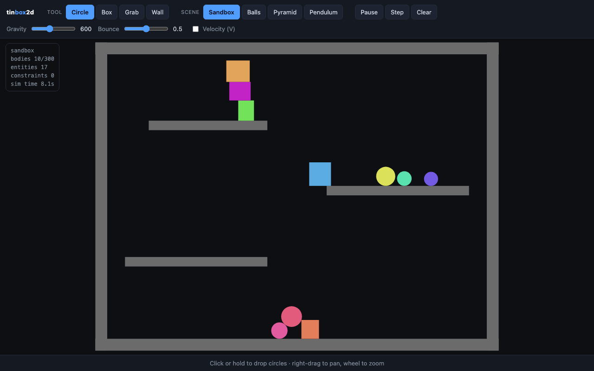
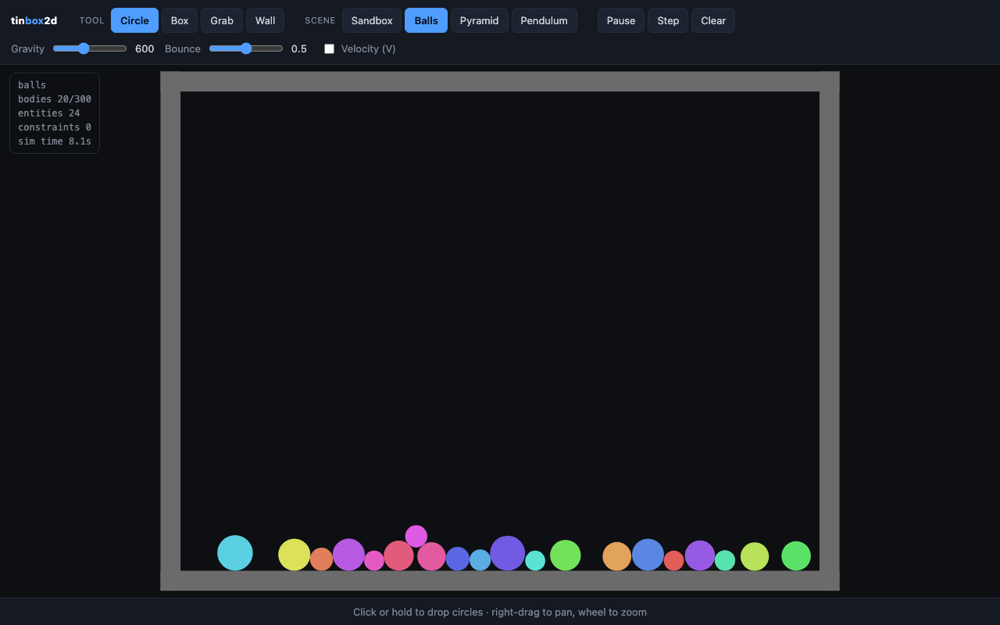
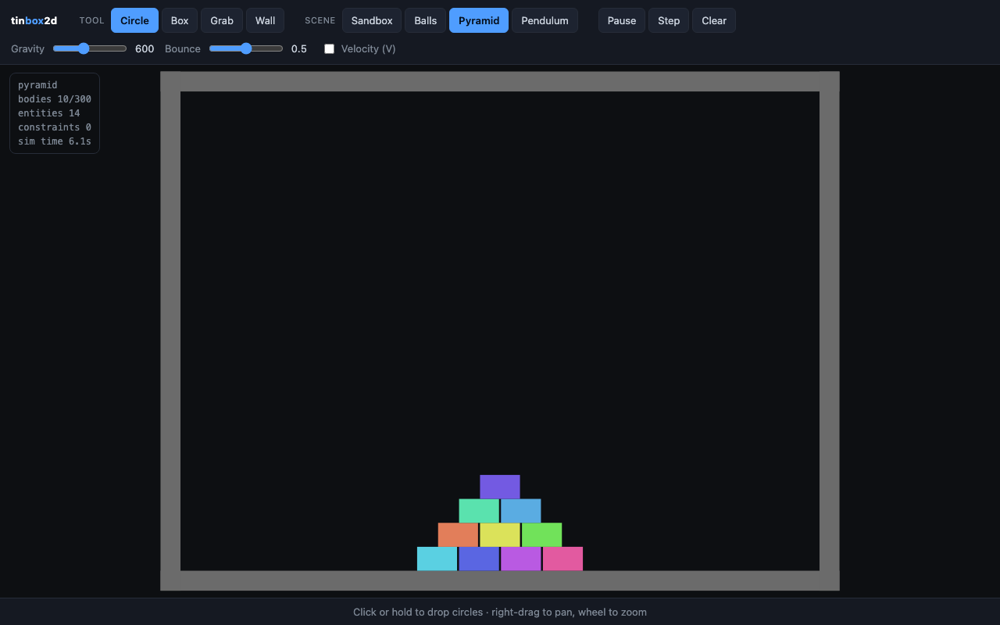
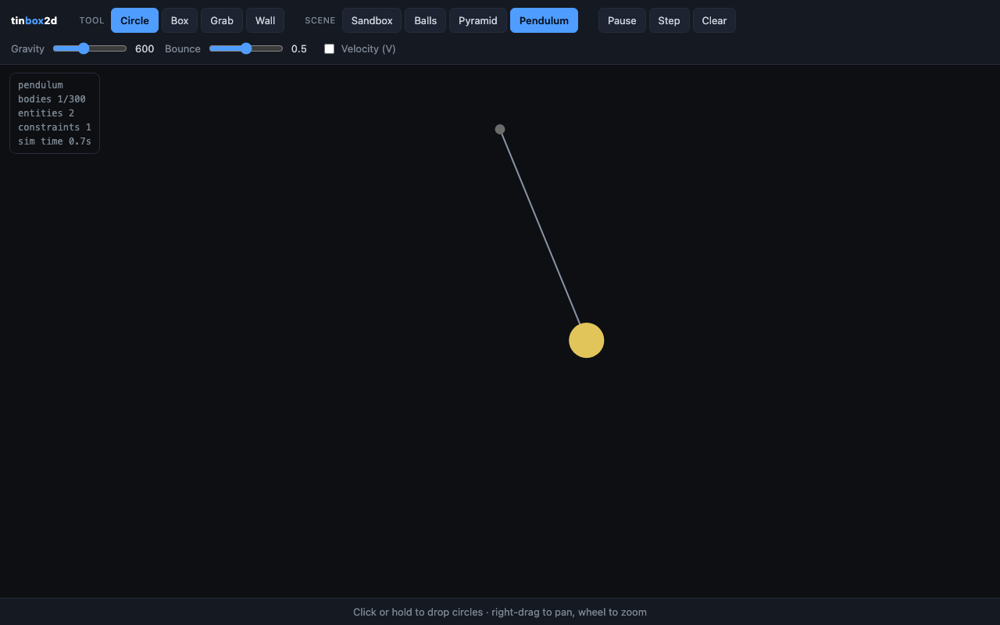

# tinbox2d

A small 2D physics engine in plain JavaScript. Try it here: https://tinbox2d.netlify.app



You can drop circles and boxes, grab and throw them, draw walls, and change gravity and bounce while it runs. There are three preset scenes too:

  

Bodies are circles and axis-aligned boxes, so nothing rotates yet. Collisions use a spatial hash to find nearby pairs and impulses with friction to push them apart. The pendulum is a distance constraint.

## Running

It uses ES modules, so serve the folder instead of opening the file directly:

```
python3 -m http.server 8000
```

Then go to http://localhost:8000.

## Controls

Pick a tool from the toolbar (or press Q, W, E, R) and click in the scene. Right-drag pans and the wheel zooms. Space pauses, N steps once, Backspace clears the bodies, and 1-4 switch scenes.

## Tests

```
npm test
```
